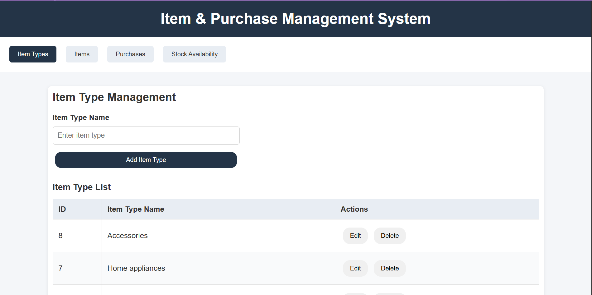
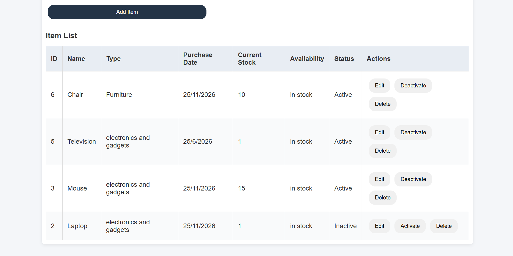
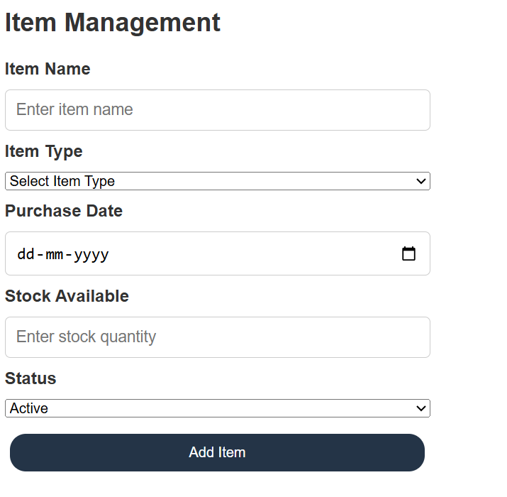
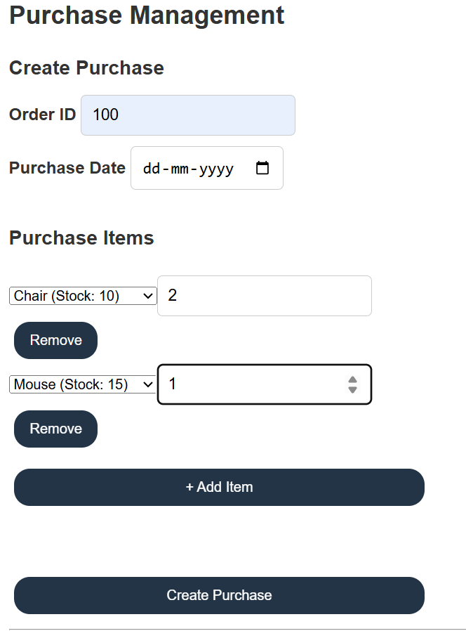
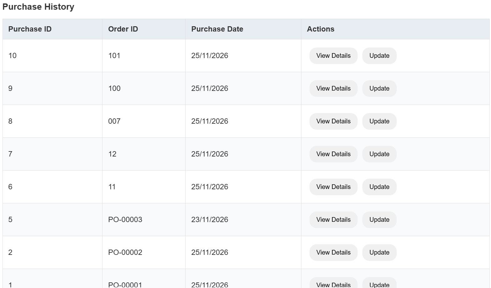
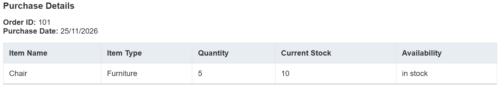
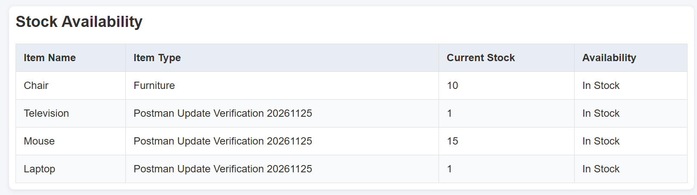

# WeAssist – Item & Purchase Management System

A full-stack web application developed using **Node.js, Express.js, MySQL, HTML5, CSS3, and JavaScript** to manage item types, inventory, purchases, purchase history, and stock availability.

This project was developed as an assignment for **Karthika Consulting & Solutions Pvt. Ltd.**

---

## Features

### 1. Item Type Management
- Create, view, update, and delete item types.
- Prevent deletion of item types associated with existing items.
- Populate item type dropdown options dynamically from the database.

### 2. Item Management
- Add and view items.
- Update item details.
- Activate and deactivate items.
- Delete items without purchase history.
- Preserve items with purchase history by marking them inactive.
- Track current stock and availability.
- Display item details along with their associated item types.

### 3. Purchase Management
- Create purchases with unique Order IDs.
- Add multiple items to a single purchase.
- Validate item status and available stock.
- Update existing purchases.
- Automatically deduct stock when purchases are created.
- Adjust stock correctly when purchases are updated.
- Maintain historical purchase records.
- Prevent purchase deletion.

### 4. Stock Availability
- View current stock for all items.
- Display In Stock and Out of Stock status.
- Refresh stock information after purchase operations.

---

## Technology Stack

| Technology | Purpose |
|---|---|
| HTML5 | Frontend structure |
| CSS3 | Styling and responsive layout |
| JavaScript | Frontend functionality |
| Node.js | Backend runtime |
| Express.js | REST API development |
| MySQL | Relational database |
| mysql2 | MySQL database connectivity |
| dotenv | Environment configuration |
| Nodemon | Development server |

---

## Project Structure

```text
weassist-item-purchase-management/
│
├── backend/
│   ├── config/
│   │   └── db.js
│   │
│   ├── controllers/
│   │   ├── itemTypeController.js
│   │   ├── itemController.js
│   │   └── purchaseController.js
│   │
│   ├── routes/
│   │   ├── itemTypeRoutes.js
│   │   ├── itemRoutes.js
│   │   └── purchaseRoutes.js
│   │
│   └── server.js
│
├── frontend/
│   ├── css/
│   │   └── style.css
│   │
│   ├── js/
│   │   └── app.js
│   │
│   └── index.html
│
├── database/
│   └── weassist_db.sql
│
├── postman/
│   └── WeAssist.postman_collection.json
│
├── screenshots/
│   ├── 01-item-types.png
│   ├── 02-item-list.png
│   ├── 03-add-edit-item.png
│   ├── 04-create-purchase.png
│   ├── 05-purchase-history.png
│   ├── 06-purchase-details.png
│   └── 07-stock-availability.png
│
├── .gitignore
├── package.json
├── package-lock.json
└── README.md
```

**Note:** The `backend/.env` file must be created locally. It is excluded from GitHub for security.

---

## Installation and Setup

### Prerequisites

Install the following software:

- Node.js (v24.19.0)
- npm (v11.17.0)
- MySQL Server (8.0.45)
- MySQL Workbench
- Visual Studio Code

### 1. Clone the Repository

```bash
git clone https://github.com/aktharahamed168/weassist-item-purchase-management.git
```

Navigate to the project directory:

```bash
cd weassist-item-purchase-management
```

### 2. Install Dependencies

Run the following command in the project root directory:

```bash
npm install
```

### 3. Create and Import the Database

1. Open MySQL Workbench.
2. Connect to your MySQL server.
3. Open the `database/weassist_db.sql` file.
4. Execute the SQL script.

The database and tables are defined in the SQL dump.

Database name:

```text
weassist_db
```

### 4. Configure Environment Variables

Create a `.env` file inside the `backend` folder.

Add the following configuration:

```env
db_host=localhost
db_user=root
db_password=YOUR_MYSQL_PASSWORD
db_name=weassist_db
```

Replace `YOUR_MYSQL_PASSWORD` with your local MySQL password.

**Important:** Never upload the `.env` file or database credentials to GitHub.

### 5. Start the Application

Run the development server:

```bash
npm run dev
```

Alternatively, use:

```bash
npm start
```

### 6. Open the Application

Open your browser and navigate to:

```text
http://localhost:5000
```

The Express server serves the frontend application and handles backend API requests.

---

## API Documentation

Base URL:

```text
http://localhost:5000/api
```

### Item Type APIs

| HTTP Method | Endpoint | Description |
|---|---|---|
| GET | `/item-types` | Retrieve all item types |
| POST | `/item-types` | Create a new item type |
| PUT | `/item-types/:id` | Update an item type |
| DELETE | `/item-types/:id` | Delete an item type |

### Item APIs

| HTTP Method | Endpoint | Description |
|---|---|---|
| GET | `/items` | Retrieve all items |
| GET | `/items/:id` | Retrieve an item by ID |
| POST | `/items` | Create a new item |
| PUT | `/items/:id` | Update an item |
| DELETE | `/items/:id` | Delete or deactivate an item |

### Purchase APIs

| HTTP Method | Endpoint | Description |
|---|---|---|
| GET | `/purchases` | Retrieve purchase history |
| GET | `/purchases/:id` | Retrieve purchase details |
| POST | `/purchases` | Create a new purchase |
| PUT | `/purchases/:id` | Update an existing purchase |

**Note:** Purchase deletion is not supported because purchase records must be preserved as historical transactions.

---

## Database Structure

The application uses four relational database tables.

| Table | Description |
|---|---|
| `item_types` | Stores item categories |
| `items` | Stores item details, category references, status, and available stock |
| `purchases` | Stores purchase order information |
| `purchase_items` | Stores items and quantities associated with purchases |

### Database Relationships

- One item type can have multiple items.
- One purchase can contain multiple purchase items.
- One item can appear in multiple purchase records.

### SQL JOIN Operations

SQL JOIN operations are used to retrieve related information:

- Items are joined with item types to display category names.
- Purchases are joined with purchase items, items, and item types to display complete purchase details.

---

## Backend Implementation

The backend follows a structured REST API architecture using Express.js.

### Key Backend Concepts

- REST API architecture.
- Controller and route separation.
- MySQL database connectivity.
- SQL JOIN operations.
- Backend input validation.
- Foreign key constraints.
- Database transactions.
- Error handling.
- Stock deduction and restoration.

### Transaction Handling

Purchase creation and updates use MySQL transactions to maintain data consistency.

The transaction process includes:

1. Begin transaction.
2. Validate selected items and available stock.
3. Insert or update purchase information.
4. Insert purchase item records.
5. Adjust item stock.
6. Commit the transaction.
7. Roll back if an operation fails.

---

## Validation and Error Handling

The application validates:

- Missing item details.
- Invalid item types.
- Non-existent items.
- Duplicate Order IDs.
- Inactive items during new purchases.
- Zero or negative purchase quantities.
- Insufficient stock.
- Item deletion when purchase history exists.

Appropriate HTTP status codes are used for validation errors, missing records, business conflicts, and unexpected server errors.

---

## Testing

The backend APIs can be tested using the included Postman collection.

### Postman Collection

The collection is available at:

```text
postman/WeAssist.postman_collection.json
```

To test the APIs:

1. Open Postman.
2. Import the collection JSON file.
3. Start the application.
4. Execute the API requests.
5. Verify the response status codes and returned data.

The collection includes requests for Item Types, Items, and Purchases.

---

## Application Screenshots

### 1. Item Type Management



### 2. Item List



### 3. Add / Edit Item



### 4. Create Purchase



### 5. Purchase History



### 6. Purchase Details



### 7. Stock Availability



---

## Author

**Akthar Ahamed**

GitHub: [aktharahamed168](https://github.com/aktharahamed168)

Project Repository: [WeAssist – Item & Purchase Management System](https://github.com/aktharahamed168/weassist-item-purchase-management)

---

**Developed as a project assignment for Karthika Consulting & Solutions Pvt. Ltd.**
